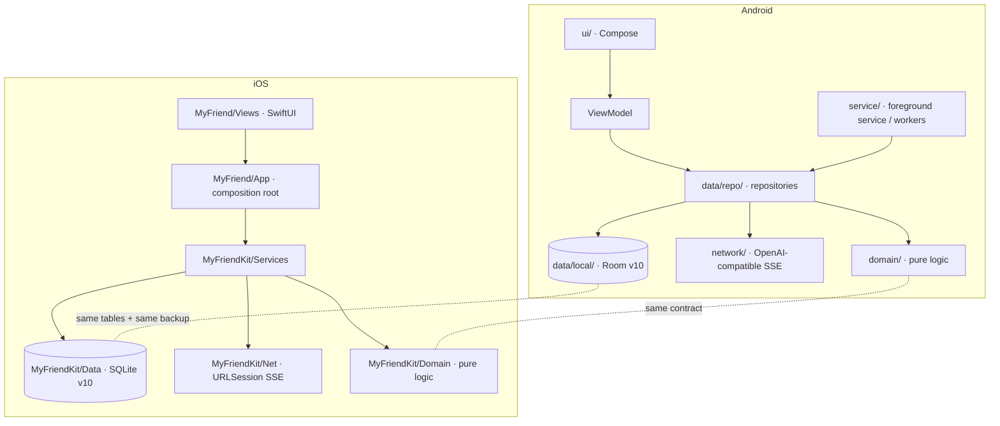
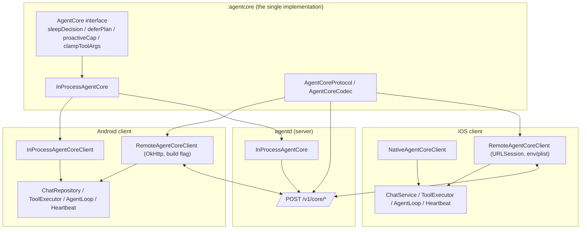

# Architecture

> [简体中文](ARCHITECTURE.md) · English
>
> Applies to `0.10.0` (internal beta) · database schema **v10** · backup format **v2**
>
> This document is for people who will write code here: the layering, the data flow, why the two
> platforms look identical yet are two separate implementations, and what the current answer is to
> "can the agent logic be written only once".

## 1. Constraints (everything below follows from these four)

| Constraint | Meaning | Consequence |
| --- | --- | --- |
| **Local-first** | Conversations, memories, personas, intents and usage stats live on the device; only LLM requests leave it | Fully usable without a server; backup is a single JSON file |
| **Cross-platform parity** | Android and iOS must behave identically and read each other's backups | Algorithms, constants, enum values and field names are a *contract*: change one side, change both |
| **Zero dependencies on iOS** | No GRDB/Ktor/Alamofire — system `SQLite3`, `URLSession` | Cheap, long-lived builds; small hand-written store layer |
| **Background is unreliable** | iOS has no long-running background work; Android foreground services can be killed | The heartbeat is opportunistic: ~30 s while in foreground, best-effort in background, caught up on foreground |

## 2. Layering

Both platforms use the same layering, with near-identical directory names:



| Layer | Android | iOS | Notes |
| --- | --- | --- | --- |
| Pure logic | `app/src/main/java/com/myfriend/app/domain/` (32 files, ~9.4k LoC) | `ios/MyFriendKit/Sources/MyFriendKit/Domain/` (18 files, ~6.3k LoC) | heartbeat, mood, memory lifecycle, vector search, `defer_reply`, sleep policy, link detection, backup codec — **no platform APIs** |
| Persistence | Room (`MyFriendDatabase` v10, schema JSON exported and verified in tests) | hand-written `SQLiteStore`, table/column names identical to Room's `10.json` | the schema is the prerequisite for backup interop |
| Network | OkHttp + hand-written SSE parser + concurrency gate | `URLSession` + hand-written SSE parser + the same gate semantics | OpenAI-compatible `/chat/completions` only; native Gemini/Claude adapters are reserved |
| Orchestration | `data/repo/` (Chat/Agent/Heartbeat/Memory/…) | `Services/` (ChatService/AgentLoop/Heartbeat/…) | decides "does he speak this turn" and "when does he reach out" |
| Presentation | Compose + ViewModel | SwiftUI + `AppEnvironment` | deliberately restrained, per the product stance |

## 3. Data flow of one conversation

```mermaid
sequenceDiagram
  participant U as User
  participant UI as UI layer
  participant S as Orchestration (ChatRepository / ChatService)
  participant G as Concurrency gate (≤3)
  participant M as Model API
  participant DB as Local database

  U->>UI: send a message
  UI->>S: send(text, attachments)
  S->>DB: persist user message
  S->>DB: write readAt (read receipt)
  S->>S: assemble system prompt (persona + memories + presence + language + tool capabilities)
  S->>S: sleep / do-not-disturb / wake-threshold decision
  alt asleep and not to be disturbed
    S->>DB: record that it was seen but not answered
    S-->>UI: read receipt only, no bubble
  else should answer
    S->>G: acquire a slot (background ≤2, chat reserves 1)
    G->>M: POST /chat/completions (stream)
    M-->>S: SSE deltas
    S-->>UI: streamed rendering
    S->>S: parse tool calls (```myfriend-tool)
    alt tool call
      S->>DB: run tool (remember / recall / mood / web search)
      S->>G: call the model again with the tool result
    end
    alt defer_reply
      S->>DB: no assistant message; write a REACH_OUT intent (earliestAt..latestAt)
    else normal reply
      S->>DB: assistant message + usage + tool trace
    end
  end
```

Three things that are easy to get wrong:

1. **Every LLM call must go through the concurrency gate** (chat, memory extraction, consolidation, scoring, heartbeat, compression, web tools). Background work that cannot get a slot must give up and log — never queue the user behind maintenance.
2. **`readAt` and "will he answer" are different things**: read ≠ will reply; with do-not-disturb even the read receipt is not written (see `docs/ROADMAP-1.9.md` §6).
3. **Tool calls and the final reply share one stream**: the model may talk while calling a tool, or call a tool and say nothing (`defer_reply`).

## 4. Why there are two implementations

| Option | Why it was not chosen | Still true? |
| --- | --- | --- |
| Kotlin Multiplatform from day one | Requires Kotlin/Native toolchain, framework packaging and Xcode integration, eating the "zero dependencies" benefit | Yes — but if sharing is the goal, KMP is the *canonical* route (see §6) |
| Client/server split from day one | Conflicts with local-first (no network ⇒ no memory, no persona) and pushes the user's API key to a server | Partly: the *stateless* decision layer can be served (see §5) |
| iOS only, Android as a thin client | Inconsistent experience, against the project's goal | — |

So both sides implement it, held together by three mechanisms:

1. **Backup fixtures** — `fixtures/backup/` (v1 read-only samples + the v2 contract); each platform has a test reading the same files;
2. **Written specs** — `docs/ROADMAP-1.9.md` and friends pin down behaviours, numbers and copy, with acceptance tables;
3. **Shared conformance cases** (new in 0.10.0) — `spec/agent-core/cases/*.json`; each platform asserts its own implementation against the same JSON.

## 5. The agent core: one implementation, three runtime shapes

"Agent logic" here means **decisions**: answer or not, when to wake, heartbeat probability, whether a memory decays, how
tool arguments are clamped. It deliberately excludes persistence — sessions, memories, intents and usage live in the
client database. That split is what makes sharing *and* serving feasible at the same time.

**Since 0.11.0 the decision layer is a single Kotlin implementation**: `agentcore/` (`:agentcore`, zero third-party
dependencies, pure JVM).



| Shape | Used by | Parity | Offline | Notes |
| --- | --- | --- | --- | --- |
| **A in-process** | Android (default), iOS (default) | ✅ one `:agentcore` implementation on Android; iOS is a contract-aligned Swift implementation | ✅ | millisecond pure functions, no round-trip |
| **B embedded service** | Android, optional | ✅ same server code | ✅ | run `agentd` on the same machine/LAN and point Android at it with `-PagentCoreRemote=true` |
| **C remote service** | both, optional | ✅ | ❌ (falls back to native on failure) | self-hosting / multi-device; off by default, clients fall back and log |

- **Contract**: the path and field-name constants in `AgentCoreProtocol` are used by the `agentd` route table and both
  clients; the 94 cases in `spec/agent-core/` run against `:agentcore` and against iOS, and the 16 in `spec/search/`
  likewise. Renaming a field turns all three red at once.
- **Server**: `agentd/` is only HTTP + JSON (`AgentCoreCodec`); all logic lives in `:agentcore`. It carries 20 tests and
  runs via `java -jar` or `installDist`, listening on loopback by default.
- **Clients**: Android's `AgentCoreClient` is an interface in `:app` (in-process / remote, chosen by
  `BuildConfig.AGENT_CORE_REMOTE`, remote failures fall back); iOS's is a Kit protocol (native / remote / fallback,
  chosen by the `MYFRIEND_AGENT_CORE` environment variable or Info.plist, native by default). **There is no user-facing
  setting.**
- **Why not KMP**: KMP would let iOS run the same Kotlin, but requires the Kotlin/Native toolchain and framework
  packaging. Establishing the contract, module boundary and client abstraction first is the higher-confidence step;
  KMP remains an option for Stage 2.

## 5.5 Search## 5.5 Search

Chat search is the same semantics implemented twice, pinned by `spec/search/` (16 cases): parameterised `LIKE`
pre-filtering (user input `%`/`_`/`\` treated literally) plus `ChineseTerms` token recall, then in-memory ranking
(matched tokens → `relevance` → time → id) over at most 500 candidates. No inverted-index table is deliberate: it would
have to be maintained on every write path and force a schema bump, while search is a low-frequency action where a
pre-filter over tens of thousands of messages is millisecond-scale.

## 6. Migration path (staged, each step revertible)

| Stage | Work | Rollback |
| --- | --- | --- |
| **Stage 0** (0.10.0, done) | `spec/agent-core` cases + assertions on both platforms; `agentd` skeleton + HTTP contract | delete the directories; clients unaffected |
| **Stage 1** | Android calls `agentd` handlers in-process and drops its duplicated decision code | keep the old implementation behind an adapter and a switch |
| **Stage 2** | iOS shares domain via KMP (framework), or talks to a remote `agentd` | remote mode off by default; KMP as an optional target |
| **Stage 3** | Server-side persistence + multi-device sync | explicitly **not** planned: it turns local-first into server-first, against the product stance |

Signal for continuing: when the case suite grows to "every behaviour change touches a dozen cases", or when the same class of divergence appears a third time, Stage 1 starts paying for itself.

## 7. Data model and versioning

- **Schema v10** — both platforms keep `user_version` in sync; `chat_sessions.personaId` is unique (one session per persona). Migrations are additive; Android verifies the exported Room schema in tests, iOS has matching migration tests.
- **Backup v2** — `format="myfriend.backup"`, `formatVersion=2`, `apiKeysOmitted=true`; v1 backups remain readable. Image binaries, avatar files and API keys are never included.
- Versioning rules: [`VERSIONING.md`](VERSIONING.md). `versionCode` and iOS `CURRENT_PROJECT_VERSION` stay equal and are decoupled from the schema version (schema increments only on table changes).

## 8. Internationalization

UI copy follows the system language (Simplified Chinese is the base, English is additional). Model-facing prompt scaffolding stays in Chinese; a `## 语言` / `## Language` section tells the model to answer in the user's language (the section itself is localised and identical on both platforms). Android uses `values/` + `values-en/`, iOS uses `zh-Hans.lproj` + `en.lproj`, and both platforms have a guard test that the key sets match. Not covered yet: Chinese error strings from Android's `data/` and `network/` layers, model-written text, and data created before the upgrade. See [`I18N.en.md`](I18N.en.md).

## 9. What keeps the platforms from drifting

| Mechanism | Location | Catches |
| --- | --- | --- |
| Backup fixtures | `fixtures/backup/`, `BackupFixtureTest` / `BackupInteropTests` | field names, encodings, enum values |
| Shared conformance cases | `spec/agent-core/cases/`, spec tests on both platforms | divergent decisions and boundaries |
| "Retired settings" guard | `SettingsRemovalGuardTest`, `SettingsRetirementTests` | re-introducing budgets and toggles that were deliberately removed |
| i18n resource guard | new in 0.10.0, strengthened in 0.10.2 | key drift, untranslated English (CJK), placeholder reordering, unused keys |
| Search contract | `spec/search/cases/` | snippet/highlight rules and ranking/filter semantics drifting |
| Independent audits | `docs/audits/` | concurrency, data integrity, security, contract drift; one per version, every P0/P1 fixed with a test |
| Migration tests | `MyFriendDatabaseMigrationTest`, `SchemaMigrationTests` | data loss on upgrade |

## 10. Known limitations

- Both chat screens load the entire message list at once (the largest memory item for long sessions); pagination is on the roadmap;
- iOS background scheduling and device-only APIs can only be fully verified on hardware (the simulator skips `BGTaskScheduler` registration);
- iOS does not run the post-`web_search` "is this worth remembering" scoring that Android has;
- The remote agent service is a skeleton: no auth, no multi-tenancy, no persistence, and no client is wired to it yet;
- English does not yet cover Android's data-layer errors or model-written text (see §8).
