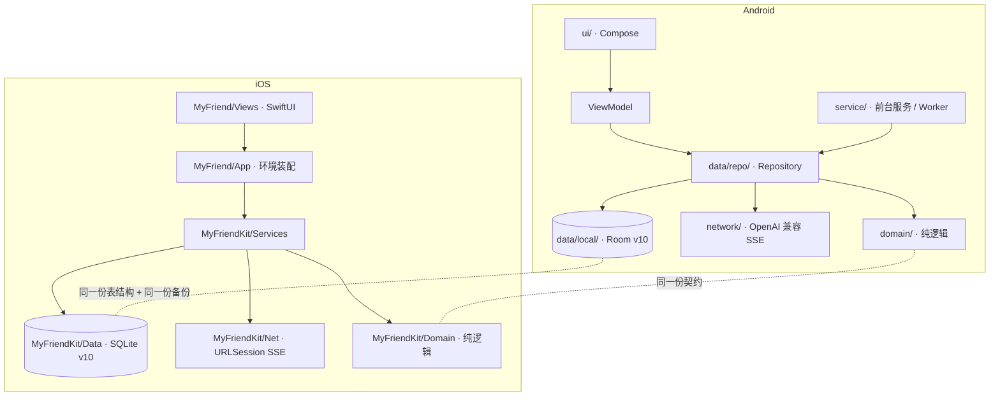
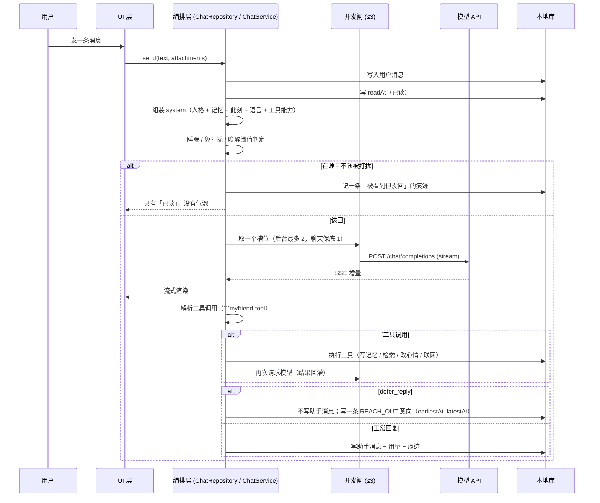
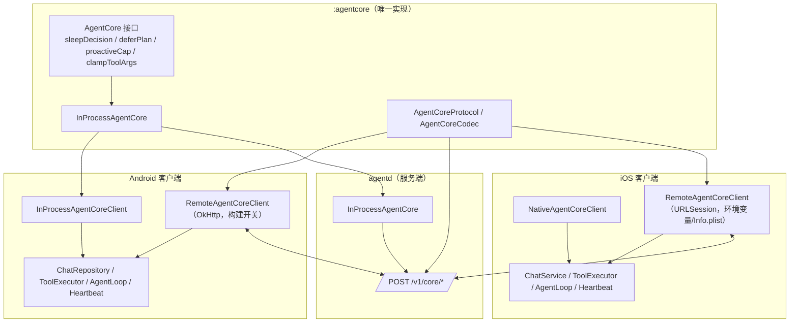

# 架构

> 简体中文 · [English](ARCHITECTURE.en.md)
>
> 适用版本：`0.10.0`（内测） · 数据库 schema **v10** · 备份格式 **v2**
>
> 这份文档写给要在本项目上写代码的人：分层、数据流、两端为什么长得一样又为什么是两份实现、
> 以及「agent 逻辑能不能只写一遍」这个问题目前的答案与迁移路径。

## 1. 约束（先看这个，后面所有设计都是被这四条推出来的）

| 约束 | 含义 | 直接后果 |
| --- | --- | --- |
| **本地优先** | 会话、记忆、人格、念头、用量全部存在设备上；只有对 LLM 的请求出网 | 没有服务端也能完整使用；备份是一份 JSON 文件 |
| **双端同构** | Android 与 iOS 必须表现一致，能互相读同一份备份 | 算法、常量、枚举值、字段名都是「契约」，改一端必须改另一端 |
| **iOS 零依赖** | 不引入 GRDB/Ktor/Alamofire，SQLite 用系统 `SQLite3`、网络用 `URLSession` | iOS 侧靠手写 store 与 Codable，编译成本低、长期不会烂在依赖上 |
| **后台不可信** | iOS 不允许常驻后台，Android 前台服务也可能被系统杀掉 | 心跳是「机会式」的：前台每 30 秒、后台尽力而为、回到前台补算 |

## 2. 分层

两端是**同一套分层**，目录名几乎一一对应：

| 层 | Android | iOS | 说明 |
| --- | --- | --- | --- |
| 纯逻辑 | `app/src/main/java/com/myfriend/app/domain/`（32 个文件 ≈ 9.4k 行） | `ios/MyFriendKit/Sources/MyFriendKit/Domain/`（18 个文件 ≈ 6.3k 行） | 心跳、心情、记忆生命周期、向量检索、`defer_reply`、睡眠判定、链接识别、备份编解码……**不依赖平台 API** |
| 持久化 | Room（`MyFriendDatabase` v10，导出 schema json 并在测试里校验） | 手写 `SQLiteStore`（表名/列名与 Room 导出的 `10.json` 逐字一致） | 表结构是备份互通的前提 |
| 网络 | OkHttp + 手写 SSE 解析 + 并发闸 | `URLSession` + 手写 SSE 解析 + 同一个并发闸语义 | 都只支持 OpenAI 兼容 `/chat/completions`，Gemini/Claude 原生适配预留 |
| 编排 | `data/repo/`（Chat/Agent/Heartbeat/Memory/…） | `Services/`（ChatService/AgentLoop/Heartbeat/…） | 决定「这一轮他说不说话」「什么时候主动」 |
| 呈现 | Compose + ViewModel | SwiftUI + `AppEnvironment` | 界面按产品立场刻意克制 |

## 3. 一次对话的数据流

三个容易写错的地方：

1. **并发闸必须包住所有 LLM 调用**（聊天、抽记忆、整理、打分、心跳、压缩、联网工具）。后台任务拿不到槽位应当**放弃并记日志**，而不是排队等用户。
2. **`readAt` 与「回不回」是两件事**：已读 ≠ 会回；免打扰时连已读都不写（见 `docs/ROADMAP-1.9.md` §六）。
3. **工具调用与最终回复是同一条流**：模型可以边说边调工具，也可以只调工具不说话（`defer_reply`）。

## 4. 为什么两端是两份实现

这是本项目最常被问到的问题，直接说结论与原因：

| 方案 | 当时为什么没选 | 现在是否还成立 |
| --- | --- | --- |
| 一开始就用 Kotlin Multiplatform | 需要 Kotlin/Native 工具链、framework 打包、Xcode 集成，且 iOS 侧「零依赖」的收益会被构建复杂度吃掉 | 仍然成立，但如果要共享，KMP 是**最正统**的路线（见 §6） |
| 一开始就做客户端/服务端分离 | 与「本地优先」冲突：没有网络就没有记忆与人格；也把用户 API Key 推到服务端 | 部分成立：**无状态**的决策层可以被服务端化（见 §5） |
| 只写 iOS 端、Android 端转发 | 两端体验会不一致，且违背项目目标 | — |

所以两端各写一份，但用三样东西把它们钉在一起：

1. **备份互通夹具**：`fixtures/backup/`（v1 只读样例 + v2 契约），两端各有一个测试读同一批文件；
2. **规格文档**：`docs/ROADMAP-1.9.md` 这类「行为规格 + 验收表」，数字与文案逐条写死；
3. **共享用例**（0.10.0 新增）：`spec/agent-core/cases/*.json`，两端各有一个测试读同一批 JSON 断言自己的实现。

## 5. Agent 核心：一份实现，三种运行形态

「agent 逻辑」在本项目里指**决策**：这一轮回不回、什么时候醒、心跳概率、记忆该不该淡、工具参数怎么夹取。
它**不包含**持久化——会话、记忆、念头、用量都在客户端数据库里。这个切分让「共享 + 服务化」同时变得可行。

**0.11.0 起决策层只有一份 Kotlin 实现**：`agentcore/`（`:agentcore`，零第三方依赖、纯 JVM）。

| 形态 | 谁在用 | 一致性 | 离线 | 说明 |
| --- | --- | --- | --- | --- |
| **A 进程内** | Android（默认）、iOS（默认） | ✅ 同一份 `:agentcore` 实现（Android）；iOS 是契约对齐的 Swift 实现 | ✅ | 毫秒级纯函数，没有网络往返 |
| **B 内嵌服务** | Android 可选 | ✅ 服务端同一份代码 | ✅ | `agentd` 可运行在同一台机器/同一局域网，Android 通过 `-PagentCoreRemote=true` 指向它 |
| **C 远程服务** | 两端都可选 | ✅ | ❌（失败自动回退本机） | 自建服务器 / 多设备场景；默认关闭，客户端会回退并记日志 |

- **契约**：`AgentCoreProtocol` 里的路径与字段名常量同时被 `agentd` 路由表和两端客户端使用；`spec/agent-core/`
  的 94 条用例由 `:agentcore` 与 iOS 各跑一遍，`spec/search/` 另 16 条同理。字段名改名会同时红三处。
- **服务端**：`agentd/` 只做 HTTP + JSON（`AgentCoreCodec`），业务逻辑全在 `:agentcore`；自带 20 条测试，
  可 `java -jar` 或 `installDist` 运行，默认只监听回环地址。
- **客户端**：Android 的 `AgentCoreClient` 是 `:app` 内的接口（进程内 / 远程两实现，`BuildConfig.AGENT_CORE_REMOTE`
  选择、远程失败回退进程内）；iOS 的 `AgentCoreClient` 是 Kit 协议（`Native` / `Remote` / `Fallback` 三实现，
  `MYFRIEND_AGENT_CORE` 环境变量或 Info.plist 选择、默认 native）。**没有用户可见的设置项**。
- **为什么不是 KMP**：KMP 能让 iOS 也跑同一份 Kotlin，但需要 Kotlin/Native 工具链与 framework 打包；
  在引入它之前，先把契约、模块边界与客户端抽象建立起来，收益更确定、风险更小。KMP 仍是 Stage 2 的可选项。

## 5.5 检索## 5.5 检索

聊天检索是**同一个语义在两端的两次实现**，靠 `spec/search/`（16 条用例）钉住：参数化 `LIKE` 粗筛
（用户输入的 `%`/`_`/`\` 按普通字符处理）+ `ChineseTerms` 词元召回 → 内存精排（命中词元数 → `relevance`
→ 时间 → id），候选上限 500。不建倒排索引表是刻意取舍：建表要把词元维护铺满每条写路径，并升 schema；
检索是低频操作，几万条消息的粗筛是毫秒级。

## 6. 迁移路径（分阶段、每步可回退）

| 阶段 | 做什么 | 回退方式 |
| --- | --- | --- |
| **Stage 0**（0.10.0，已落地） | `spec/agent-core` 用例 + 两端断言测试；`agentd` 骨架 + HTTP 合约 | 删掉目录即可，客户端不受影响 |
| **Stage 1** | Android 改为直接调用 `agentd` 的 handler（同进程），删除 Android 侧重复的决策代码 | 保留旧实现为 `:app` 内的一份适配层，一个开关切回 |
| **Stage 2** | iOS 通过 KMP 共享 domain（生成 framework），或接远程 `agentd` | 远程模式默认关闭；KMP 作为可选 target 存在 |
| **Stage 3** | 服务端持久化 + 多设备同步 | 明确**当前不做**：它会把「本地优先」变成「服务端优先」，与产品立场冲突 |

判断是否值得继续投入的信号：当 `spec/agent-core` 的用例数增长到「每次改行为都要改十几条用例」，
或两端出现第三次同类的行为不一致时，Stage 1 的收益就压过了维护契约的成本。

## 7. 数据模型与版本

- **schema v10**：两端 `user_version` 一致；`chat_sessions.personaId` 上有唯一索引（一人一段会话）。
  迁移只增不减，Android 的 Room 导出 schema 在测试里校验，iOS 侧有对应的迁移测试。
- **备份 v2**：`format="myfriend.backup"`、`formatVersion=2`、`apiKeysOmitted=true`；v1 备份仍可读。
  图片二进制、头像文件、API Key **不进备份**。
- 版本规则见 [`VERSIONING.md`](VERSIONING.md)；`versionCode` 与 iOS `CURRENT_PROJECT_VERSION` 保持相等，
  与 schema 版本解耦（schema 只在表结构变化时 +1）。

## 8. 国际化

UI 文案跟随系统语言（中文为默认/base，英语为附加语言）；模型面向的提示词脚手架保持中文，
通过 `## 语言` / `## Language` 一节告诉模型「用对方的语言回答」（该小节随界面语言本地化，两端逐字一致）。
Android 侧 `values/` + `values-en/`，iOS 侧 `zh-Hans.lproj` + `en.lproj`，两端都有「键集合必须一致」的守卫测试。
尚未覆盖的：Android `data/` 与 `network/` 层的中文错误、模型产出的文本、升级前已有数据。详见 [`I18N.md`](I18N.md)。

## 9. 一致性保障（谁在防止两端跑偏）

| 机制 | 位置 | 拦得住什么 |
| --- | --- | --- |
| 备份夹具互读 | `fixtures/backup/`、两端 `BackupFixtureTest` / `BackupInteropTests` | 备份字段名、编码、枚举值漂移 |
| 共享用例 | `spec/agent-core/cases/`、两端 spec 测试 | 决策逻辑的取值/边界不一致 |
| 「消失的设置」守卫 | Android `SettingsRemovalGuardTest`、iOS `SettingsRetirementTests` | 把删掉的额度/开关又加回来 |
| i18n 资源守卫 | 两端资源一致性测试（0.10.0，0.10.2 加强） | key 漂移、英文未翻译（含 CJK）、格式符错位、死键 |
| 检索契约 | `spec/search/cases/` | 摘要/高亮规则与排序过滤语义漂移 |
| 独立审计 | `docs/audits/` | 并发、数据完整性、安全、契约漂移；每版一次，P0/P1 必须带测试修复 |
| 迁移测试 | Android `MyFriendDatabaseMigrationTest`、iOS `SchemaMigrationTests` | 老库升级丢数据 |

## 10. 已知限制

- 聊天页两端都一次性加载整段消息列表（长会话内存的最大一块），分页在路线图上；
- iOS 的工具链与后台调度只能在真机上完整验证（模拟器跳过 `BGTaskScheduler` 注册）；
- iOS 的 `web_search` 之后没有「值不值得记」的打分（Android 有）；
- 远程 agent 服务目前只是骨架：没有鉴权、没有多租户、没有持久化，客户端还没有接线；
- 英文尚未覆盖 Android 数据层错误与模型产出的文本（见 §8）。
